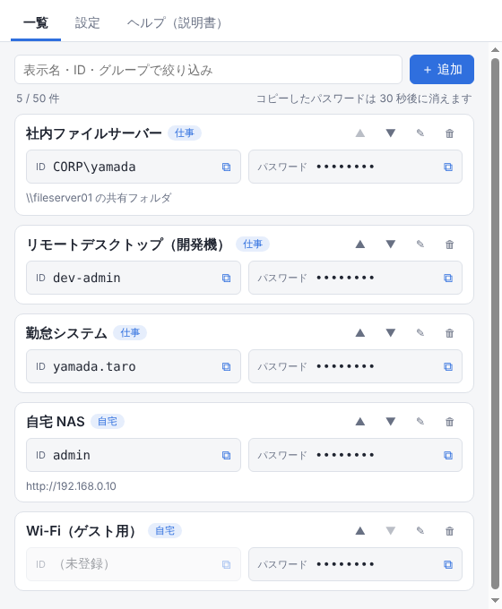

# PassCopy

登録した **ID とパスワードをワンクリックでコピーできる** Windows 用の無料ツールです。
「Windows セキュリティ」の資格情報画面など、ID とパスワードを何度も入力する場面で、一覧からクリックしてコピーし、貼り付けるだけで入力できます。

- 登録は **最大 50 件**
- **完全オフライン**（インターネットに一切接続しない）
- 保存データは **Windows の DPAPI で暗号化**。任意でマスターパスワードも設定できる



## 主な機能

| 分類 | 内容 |
|---|---|
| コピー | ID・パスワードの欄をクリックするだけでコピー。パスワードは設定した秒数（初期 30 秒）でクリップボードから自動で消える |
| 登録 | 表示名・グループ・ID・パスワード・メモ。最大 50 件。並べ替え・絞り込み・ランダムなパスワードの作成 |
| 呼び出し | タスクトレイに常駐。ショートカット（初期 Ctrl+Alt+P）で一覧を開く・閉じる |
| 保護 | DPAPI で暗号化して保存。マスターパスワード（任意）でロック、一定時間操作がなければ自動ロック |
| 移行 | パスワード付きのバックアップファイル（.pcbak）で書き出し・読み込み |
| 説明書 | [使い方説明書](docs/使い方説明書.md) を同梱。画面の「ヘルプ（説明書）」タブから読める |

## インストール

GitHub の Actions タブ →「Windows build」の最新の実行結果 → Artifacts の `PassCopy-Windows` をダウンロードして展開します。

- `PassCopy-Setup-x.y.z.exe`: インストーラー（スタートメニューとデスクトップにショートカットを作成）
- `PassCopy-Portable-x.y.z.exe`: インストール不要版

初回起動時に「Windows によって PC が保護されました」と出た場合は、「詳細情報」→「実行」を押してください（コード署名をしていないために表示されます）。

## 開発者向け

```bash
npm install
npm start          # 開発用に起動
npm run check      # 構文チェックと、保存・暗号化・上限 50 件のテスト
npm run smoke      # 実際に起動して、暗号化保存・コピーと自動消去・通信の遮断を確かめる（CI でも実行）
npm run dist       # Windows 上でインストーラーとポータブル版を作成（dist/）
```

| ファイル | 役割 |
|---|---|
| `src/main.js` | 起動・タスクトレイ・ショートカット・コピーと自動消去・通信の遮断・画面との受け渡し |
| `src/vault.js` | 登録情報の検証（上限 50 件）・暗号化（DPAPI / AES-256-GCM + scrypt）・バックアップ |
| `src/preload.js` | 画面から呼べる処理を限定して公開 |
| `src/renderer/` | 一覧・設定・ヘルプ画面 |
| `scripts/check.js` | 単体テスト |
| `scripts/smoke.js` | 起動しての動作確認（GitHub Actions の Windows 環境で実行） |
| `scripts/shots.js` | スクリーンショットの撮影（`PC_SHOTS=1`） |

### 完全オフラインのしくみ

- 通信するモジュールを使っていません（`scripts/check.js` で検査）。
- 画面は同梱ファイルだけを表示し、`file:` 以外への通信はすべて取り消します。新しい窓やページ移動も禁止しています。
- 自動更新・スペルチェック辞書のダウンロードなど、Electron が通信する機能は使っていません。

### 保存形式

`%APPDATA%\PassCopy\vault.json` に保存します。中身は `{ entries, settings }` の JSON を、マスターパスワードがあれば AES-256-GCM（鍵は scrypt）で暗号化し、さらに DPAPI（Electron の `safeStorage`）で暗号化したものです。
